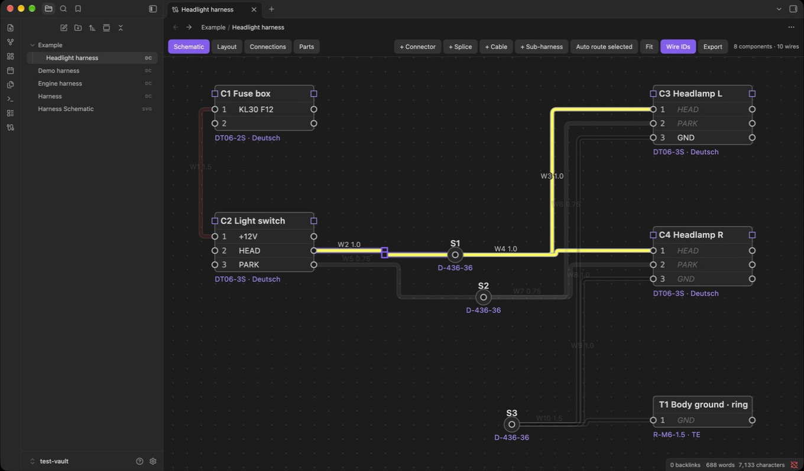
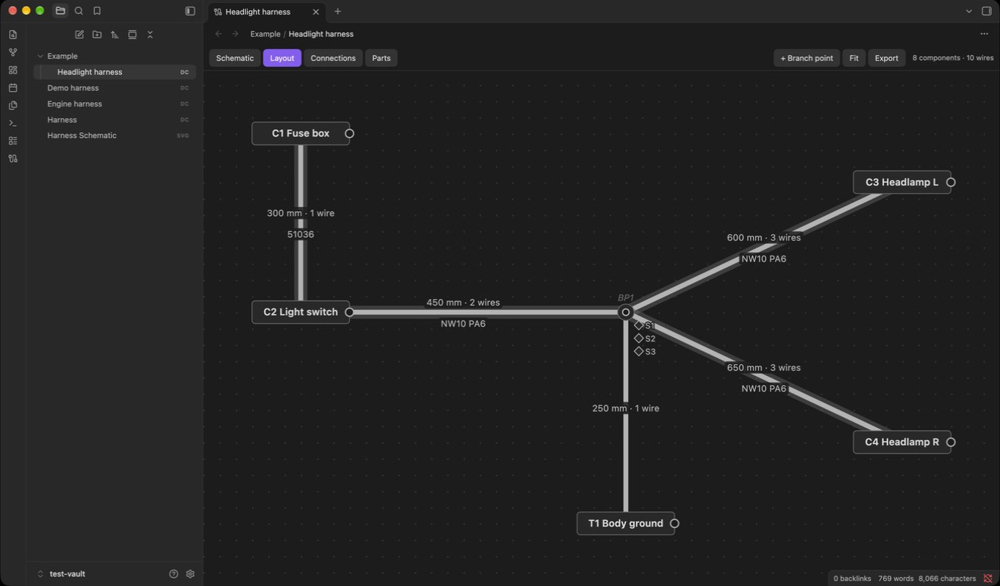
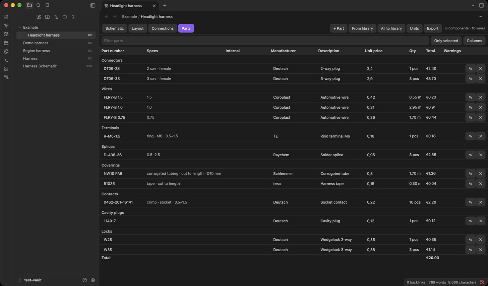
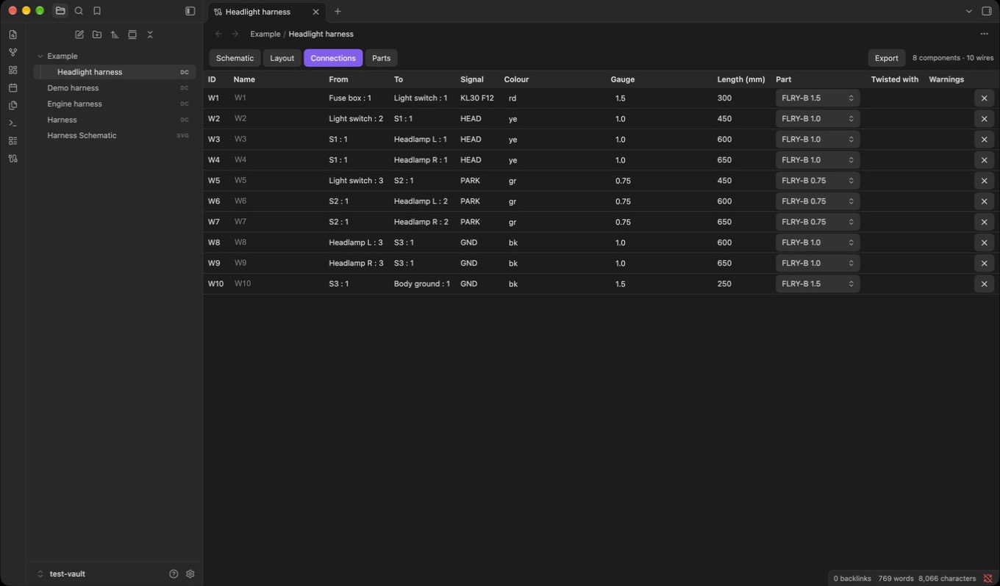
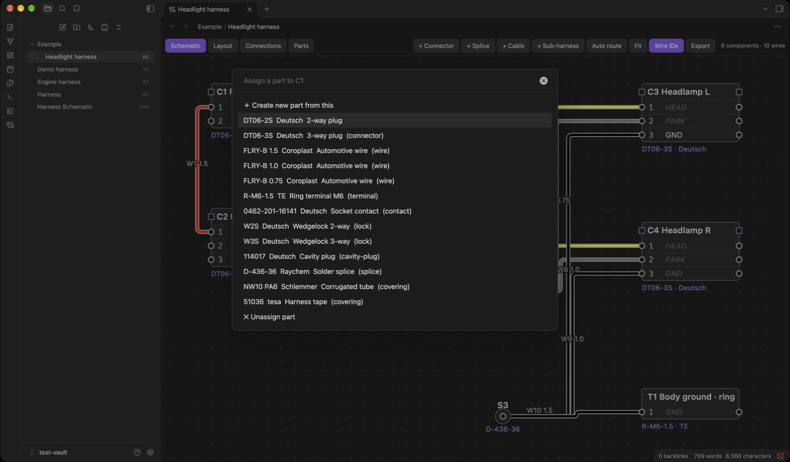

# DC Wiring

Design automotive wire harnesses inside Obsidian. Draw the schematic, lay out the bundles, and get the wiring list and bill of materials from the same file. The harness lives in your vault next to your notes, datasheets and photos.



Each harness is a `.DC` file. It opens with four tabs:

- **Schematic**: connectors, splices, terminals, cables, diodes, resistors and notes.
  - Drag from pin to pin to draw wires.
  - Auto-route the wires.
  - Name signals and see whole nets highlighted.
- **Layout**: the physical harness.
  - Bundles with lengths and branch points.
  - Wire lengths follow the bundles they run through.
  - Add coverings such as corrugated tube, tape or heat shrink.
- **Connections**: the wiring list. From, to, colour, gauge, length and part for every wire.
- **Parts**: the bill of materials. Counted from what you assigned, priced, and grouped by part type.

| Layout | Parts |
|---|---|
|  |  |
| **Connections** | **Assign part** |
|  |  |

## Features

**Schematic**
- Connectors with any pin count or a pin grid (`2x4`), cavity names (`A1`, `B2`), signals, and pins marked not connected.
- Splices, terminals, cables with cores and a shield, twisted wires, diodes and resistors. Nets stop at diodes and resistors.
- Typed wiring: select a connector and type where each cavity goes.
- Undo and redo, search, multi-select, groups, mated connectors and images.

**Sub-harnesses.** Use another `.DC` file as a block in this one. Its parts are added to this harness's parts list, and links survive renames.

**Parts**
- Typed parts: connector, wire, cable, terminal, contact, splice, covering and accessories.
- Each type has its own fields: cavities, gauge range, cores, covering type and so on.
- Right-click → **Assign part**. Parts that fit come first, or create a part from the component.
- Configurations add accessories automatically, for example contacts per cavity by wire gauge, cavity plugs and seals, or boots.
- Choose a contact per cavity by hand when needed.
- Part libraries (`.DClib`) are shared between harnesses, with push and pull to keep parts in step.
- Checks: wrong cavity count, contact doesn't fit the wire gauge, duplicate part number, wire without a part.

**Units.** mm², AWG, cmil and kcmil gauges, with conversion. Lengths in mm, cm, m, in, ft or yd, and you can type sums like `40 + 30 + 2 * 15cm`.

**Exports**
- Parts list (BOM), connections, wiring tables per connector and cut list, as CSV.
- Schematic as SVG.
- A report as HTML, or printed to PDF.

## Getting started

1. Install **DC Wiring** from *Settings → Community plugins*.
2. Run **DC Wiring: New harness** from the command palette, or click the cable icon in the ribbon.
3. On the Schematic, right-click the empty canvas to add connectors and splices. Drag from one pin to another to draw a wire.
4. Open the **Parts** tab, click **+ Part**, then right-click a component or wire → **Assign part**.
5. Use **Export** in the toolbar for the parts list, wiring list or a printable report.

## Commands

- New harness / New part library
- Open layout beside schematic
- Add all harness parts to a part library / Add a part from a part library
- Export BOM, connections, wiring tables or cut list (CSV), schematic (SVG), report (HTML), or print the report as PDF
- Edit title block and notes

## The file format

A `.DC` file is plain JSON, so you can keep it in git, compare versions, and let scripts or AI agents edit it. The format is described in [docs/harness-format.md](docs/harness-format.md), with a JSON Schema in [docs/harness.schema.json](docs/harness.schema.json). From 1.0 on, files that follow it keep opening in later 1.x versions.

## Limits of 1.0

- Desktop only. Phones and tablets are not supported yet.
- There is no formboard drawing, bundle thickness calculation or manufacturer parts catalog.
- Part images show in the part editor, not on the canvas.

## Development

```bash
npm install
npm run dev     # rebuilds into test-vault/.obsidian/plugins/dc-wiring on every change
npm test        # unit tests (Node 23.6 or later runs the TypeScript directly)
npm run build   # type check and build main.js for a release
```

Open `test-vault` as a vault in Obsidian to try changes. `test-vault/Example/Headlight harness.DC` is the harness in the screenshots.

The demo video is a [HyperFrames](https://github.com/heygen-com/hyperframes) project in `docs/demo-video`: run `npm run render` there to make the MP4.

## License

[MIT](LICENSE)
